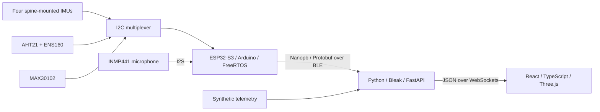

# ThunderClock

**A wearable worker-safety prototype that connects spine motion, environmental sensing, and pulse measurements to a live 3D view.**

Built for NatHacks 2026, ThunderClock explores how a supervisor could understand a worker's posture and surrounding conditions together. Four IMUs placed along the spine track the orientation of the pelvis, lumbar, thoracic, and upper-thoracic regions. Additional sensors capture relative noise level, temperature, humidity, air-quality estimates, heart rate, and an experimental SpO2 estimate.

The project spans embedded C++ on an ESP32-S3, real-time scheduling with FreeRTOS, compact Protobuf messages over Bluetooth Low Energy, an asynchronous Python backend, and a React/Three.js visualization. It also includes a separate fall/near-fall detection pipeline and a physics-based simulator for exercising that pipeline before testing on people.

ThunderClock is a hackathon prototype. Its posture model, environmental indicators, and physiology estimates are not medically or occupationally certified measurements.

## From sensors to the browser



The wearable owns sensor acquisition and on-device orientation fusion. The laptop receives and validates packets, computes neutral-relative posture, and publishes application telemetry. The browser consumes that telemetry through the backend, keeping hardware protocols out of the visualization.

## Hardware

| Component | Role |
| --- | --- |
| Adafruit ESP32-S3 Feather | Wearable controller, sensor processing, FreeRTOS tasks, BLE peripheral, and battery-operation status LED |
| Two ICM-20948 IMUs | Pelvis and upper-thoracic motion anchors |
| Two MPU-6050 IMUs | Lumbar and thoracic motion anchors |
| PCA9548 / TCA9548A I2C multiplexer | Selects individual sensors on the shared I2C bus, including devices with matching addresses |
| AHT21 | Ambient temperature and relative humidity |
| ENS160 | AQI, estimated CO2-equivalent concentration, and estimated total volatile organic compounds |
| INMP441 I2S microphone | Relative environmental loudness |
| MAX30102 | Red/infrared optical pulse signals for heart-rate and SpO2 estimation |

The IMU slot order is **pelvis, lumbar, thoracic, upper thoracic**, on mux channels 0-3. Although the ICM-20948 contains a magnetometer, all four anchors use **six-axis fusion: accelerometer and gyroscope only**.

## What we built

### Embedded acquisition and real-time scheduling

The firmware uses **C++17, the Arduino framework, and PlatformIO**. Small sensor classes expose familiar `begin()` and `read()` methods, while [FirmwareTypes.h](firmware/include/FirmwareTypes.h) defines the shared measurement structs and snapshot format.

**FreeRTOS** separates the fast IMU stream from snapshot processing. The IMU task targets a four-sensor strip every 10 ms, or 100 Hz, and sends raw measurements over BLE. A one-element queue hands the latest strip to the acquisition task at approximately 20 Hz for orientation processing and snapshot publication. An I2C mutex protects mux selection and sensor transactions across tasks.

[SystemConfig.h](firmware/include/SystemConfig.h) centralizes pins, timing, sensor addresses, and feature toggles. The onboard NeoPixel gives feedback without a USB console: **blinking blue** while advertising, **solid green** when BLE is connected, and **solid red** after a detected startup or BLE failure.

### Sensor fusion and posture

[ImuManager](firmware/src/ImuManager.cpp) groups the four IMUs into one acquisition interface. Adafruit's **ICM20X, MPU6050, Unified Sensor, and BusIO** libraries support sensor configuration and reads; the ICM acquisition path reads acceleration and angular velocity without collecting magnetometer data.

[OrientationProcessor](firmware/src/OrientationProcessor.cpp) runs an independent **x-io Fusion AHRS filter** and gyro-bias estimator for each anchor. It converts raw acceleration and angular velocity into the units expected by Fusion, uses acquisition timestamps for integration, and produces normalized **quaternions in `[w, x, y, z]` order**. Per-sensor validity, startup settling, repeated timestamps, and long sample gaps are handled explicitly.

Quaternions provide the common rotation representation across firmware, Python, and Three.js. The backend can capture an upright neutral reference, calculate adjacent-segment rotations, derive forward and lateral bend angles, and produce sustained-bend warnings. Six-axis fusion keeps tilt referenced to gravity, but heading can drift; physical mounting and calibration remain important.

### Environmental and pulse signal processing

- **Temperature, humidity, and air quality:** `EnvironmentManager` wraps AHT21 and ENS160 together. It schedules AHT21 conversions without waiting inside the shared I2C lock, checks its data CRC, and uses temperature/humidity readings to compensate the ENS160. ENS160 samples are forwarded even during its warm-up or invalid-quality states for backend interpretation. Latest received environment values persist between snapshot updates.
- **Relative loudness:** `AudioMonitor` captures the INMP441 through **I2S at 16 kHz**, processes 512-frame windows, removes DC offset, and calculates a logarithmic level from signal power. The transmitted value is a relative noise trend requiring calibration for physical sound-pressure measurements; raw audio is not sent in the telemetry packet.
- **Heart rate and SpO2:** `HeartRateMonitor` configures the MAX30102, drains its red/IR FIFO, and handles skin contact and overflow recovery. The project's `BeatDetector` removes the baseline, smooths the signal, detects adaptive-threshold peaks, and averages beat intervals. `Spo2Estimator` uses per-beat red/IR AC-to-DC ratios to produce an uncalibrated prototype estimate.
- **Heat context:** the backend includes a temperature/humidity-to-humidex helper for further environmental interpretation.

### Compact wireless telemetry

**Protocol Buffers** define the device messages, and **nanopb** generates bounded C structures and encodes them into byte arrays on the ESP32. Python bindings decode the same schema on the laptop.

**NimBLE-Arduino** provides the BLE peripheral, advertising, connection callbacks, and GATT characteristics. The prototype advertises as `THUNDER CLOCK` with service `AAAA`:

| Characteristic | Content |
| --- | --- |
| `8888` | Four raw accelerometer/gyroscope records with collection uptime |
| `8889` | Versioned orientation snapshots, sequence number, collection uptime, and optional environment, noise, heart-rate, and SpO2 fields |

Each notification carries one complete Protobuf packet. Separate raw and fused streams support both motion-analysis experiments and the live posture view. Generated bindings, synthetic packet fixtures, and a nanopb/Python conformance harness help keep the embedded and Python implementations compatible.

### Python gateway and posture processing

The backend uses **Bleak** for BLE discovery and subscriptions, **asyncio** for acquisition and publication, and **FastAPI/Uvicorn** for HTTP and WebSocket delivery.

BLE callbacks copy bytes and original receipt times into a bounded queue. Decoding, validation, recording, and application processing happen outside the callbacks. Diagnostics track received, decoded, rejected, and dropped packets, sequence gaps, probable restarts, and local receipt age.

The same application pipeline accepts live hardware or explicitly selected synthetic telemetry. An optional `raw_fusion` mode estimates orientation on the laptop from raw BLE packets. A raw-sample callback also provides a handoff for detector integration.

| Endpoint | Purpose |
| --- | --- |
| `GET /health` | API liveness and selected telemetry source |
| `GET /diagnostics` | Connection state and stream counters |
| `POST /posture/calibrate` | Capture or recapture the backend's neutral reference |
| `WS /ws/telemetry` | Shared application snapshots at approximately 20 Hz |

### Interactive 3D spine visualization

The current frontend is a focused sensor-test viewer built with **React, TypeScript, Vite, Three.js, and WebGL**. It constructs a vertebral column from the sacrum through T1 and drives it from four measured orientation anchors.

Its visualization includes:

- **Cubic Hermite interpolation in rotation-vector space**, with quaternion SLERP as a comparison mode, to blend the four anchors into a continuous spine pose.
- A live sensor curve, visible sensor pods, and optional local-axis helpers for checking mounting.
- Orbit controls and oblique, side, and back camera presets.
- Per-sensor freshness colors, quaternion readouts, connection state, and measured message rate.
- Automatic WebSocket reconnection and a built-in bend/extension/side-bend/twist animation that works without a backend.
- Browser-local neutral capture for quickly aligning the displayed pose.

The viewer's **Set neutral** control recenters the rendering locally; it is separate from the backend calibration endpoint. Geometry between anchors is visual interpolation, not additional anatomical measurement.

### Fall detection and ThunderSim

The [detection](detection/models/README.md) tools explore fall, near-fall, and man-down events using raw acceleration and angular velocity. A threshold stage identifies candidate events, followed by a feature-based classifier using motion and post-event context across the four anchors. The implementation includes **gradient-boosted trees**, a portable **logistic-regression fallback**, streaming/resampling support, and additional near-fall processing.

The research tooling uses **NumPy, SciPy, scikit-learn, joblib, and pandas**, with training/evaluation scripts, recorded-data fixtures, and model reports. Its data preparation includes the Erciyes simulated-fall and VTT-ConIot construction-activity datasets; two intermediate spine anchors are synthesized for those recordings. Dataset attribution and evaluation details are in the model README.

[ThunderSim](detection/simulation/README.md) generates four-anchor motion from a physics-based body model, emulates sensor filtering, noise, clipping, and sequential sampling, and models BLE packet loss and outages. It exercises the real Protobuf/backend decoder path and produces scenario reports and **Matplotlib** plots. This supports repeatable tests of falls, construction activities, missing sensors, and long fall-free shifts. These tools are separate from the current live WebSocket fall-state output, which is not yet integrated.

## Try the project

### Run the viewer with simulated telemetry

Requirements: Python 3.11 or later, Node.js, and npm. Start each terminal from the repository root.

**Terminal 1 - backend:**

```sh
cd backend
python -m venv .venv
source .venv/bin/activate
python -m pip install -r requirements-api.txt
TELEMETRY_SOURCE=simulated python -m uvicorn app.main:app --host 127.0.0.1 --port 8000
```

**Terminal 2 - frontend:**

```sh
cd frontend
npm ci
npm run dev
```

Open **http://localhost:5173**. The simulated backend supplies a repeatable posture stream. The viewer's **Test bend** button provides an additional browser-only demonstration. On Windows, activate the virtual environment and set environment variables using the corresponding PowerShell commands.

### Build and connect the wearable

With PlatformIO installed, run from the repository root:

```sh
pio run -d firmware
pio run -d firmware -t upload
```

Check wiring, mux channels, and the feature flags in [SystemConfig.h](firmware/include/SystemConfig.h) before uploading. The current configuration enables IMUs and BLE; environment, audio, and heart-rate initialization are individually switchable and currently disabled.

From `backend/`, with its virtual environment active, discover the device:

```sh
python -m app.cli scan --timeout 5
```

Stop the simulated API, then start the hardware source using the exact OS device ID returned by the scan:

```sh
TELEMETRY_SOURCE=hardware DEVICE_ID="<device ID>" DEVICE_FORMAT=both \
  python -m uvicorn app.main:app --host 127.0.0.1 --port 8000
```

Use one process to own the wearable connection. `both` subscribes to raw and fused characteristics; `quaternion` selects fused telemetry alone. See [BLE diagnostics](backend/DIAGNOSTICS.md) for single-stream inspection, JSONL recording, raw-fusion mode, and physical acceptance checks.

## Repository guide

| Directory | Contents |
| --- | --- |
| [`firmware/`](firmware/) | ESP32-S3 drivers, fusion, FreeRTOS tasks, nanopb schemas, BLE status, and native C++ checks |
| [`backend/`](backend/README.md) | BLE CLI, packet decoding, FastAPI service, posture processing, simulation source, and Python tests |
| [`frontend/`](frontend/README.md) | React/Three.js spine viewer and visualization math |
| [`protocol/`](protocol/README.md) | Shared orientation contract, generated bindings, and cross-language fixtures |
| [`detection/models/`](detection/models/README.md) | Fall/near-fall models, datasets/fixtures, training, evaluation, and streaming adapters |
| [`detection/simulation/`](detection/simulation/README.md) | ThunderSim physics, sensor/link emulation, scenarios, plots, and regression checks |
| [`docs/`](docs/) | Product scope, architecture, firmware boundary, and application telemetry contract |

Native firmware checks cover the beat/SpO2 algorithms, environment acquisition behavior, and BLE LED transitions. Backend tests cover packet validation, BLE lifecycle, freshness, posture, and simulated telemetry. The detector and simulator have their own test suites and evaluation tools; their READMEs describe how to run them.

## Current scope and next steps

The implemented foundation includes wearable sensor acquisition, firmware fusion, raw/fused BLE telemetry, backend posture processing, the live 3D spine viewer, and separate detector/simulation tooling. The current browser page focuses on spine visualization; environment readings can reach backend telemetry, while the wearable's pulse readings are decoded but are not yet published as live dashboard physiology.

A unified supervisor dashboard with environmental and physiology panels, integrated fall alerts, and a combined risk display remains further integration work. OpenBCI Cyton/BrainFlow EEG acquisition is also a planned extension through the laptop, independent of the ESP32.

Sensor warm-up, calibration, mounting, packet capacity, and measured timing all matter when moving from a repeatable demo to hardware use. Simulator and laboratory results do not establish real-world worker-safety performance. See the [orientation and physical acceptance guide](firmware/ORIENTATION.md), [BLE contract](protocol/ORIENTATION.md), and [frontend telemetry contract](docs/TELEMETRY_PROTOCOL.md) for the detailed interfaces and limits.
