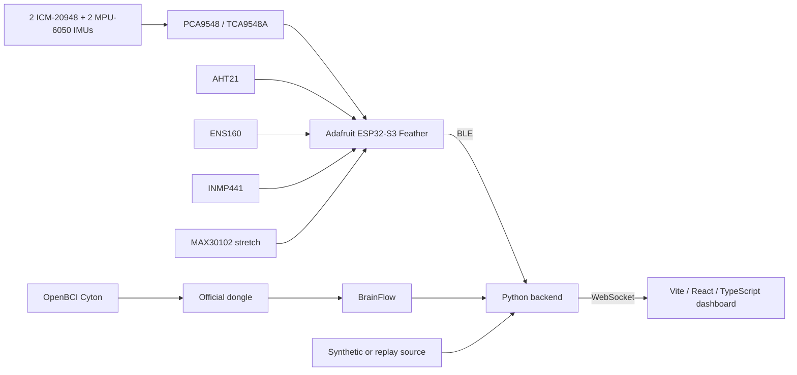

# ThunderClock system architecture

This document defines the planned service boundaries. Firmware currently has
unimplemented module interfaces and disabled task shells. Hardware inventory
and feature scope are in [PRODUCT.md](PRODUCT.md).

## Architectural commitments

- The browser communicates only with the Python backend.
- All hardware data enters through the backend. Backend-to-frontend realtime
  delivery uses WebSockets.
- Firmware owns IMU calibration and fusion and produces four normalized
  quaternions in `[w, x, y, z]` order.
- The backend owns neutral references, relative posture and higher-level risk logic.
- OpenBCI Cyton reaches the laptop through its official wireless dongle.
- The frontend must work entirely from simulated telemetry and render the same
  application contract for live, simulated and replay sources.
- Four measured anchors support a 3D posture approximation. Geometry between
  anchors is visual interpolation.

## Planned data flow

## Firmware

Use PlatformIO with Arduino on the Adafruit ESP32-S3 Feather, product #5477.
Start with familiar setup()/loop(), plain structs, a shared snapshot mutex and
small modules. Introduce FreeRTOS tasks as actual scheduling needs arise.

Firmware selects mux channels, acquires sensor samples, maintains independent
per-IMU calibration/fusion and encodes bounded BLE packets. Acquisition owns I2C
after startup. Fusion consumes samples before a latest-value telemetry queue
can replace output snapshots.

AHT21 supplies temperature/humidity, ENS160 supplies air-quality estimates and
INMP441 supplies a relative noise trend. MAX30102 is a stretch feature.
Keep acquisition time, units, validity and loss diagnostics explicit.

See [firmware guidance](../firmware/AGENTS.md) and
[orientation targets](../firmware/ORIENTATION.md).

## Backend

Start with the [standalone BLE diagnostic CLI](../backend/DIAGNOSTICS.md).
One reader owns a device. Keep callbacks bounded, decode outside callbacks and
select the packet format explicitly. Preserve signed raw readings and gravity.
Fusion and gravity subtraction remain firmware concerns.

The optional FastAPI service uses one explicitly selected source. BLE and
synthetic samples share the same posture processor. It owns neutral capture,
neutral-relative joint quaternions, angles and sustained bend warnings. It publishes
`WorkerTelemetry` over `/ws/telemetry` at about 20 Hz with per-IMU freshness
and source labels. Raw mode leaves orientations unavailable.
[Frontend contract and rig instructions](TELEMETRY_PROTOCOL.md)

Fall/impact, EEG and combined risk are separate future work. Add NumPy, SciPy or
BrainFlow when their implementation needs them.

## Frontend

Use Vite, React and TypeScript. Render backend application telemetry and source,
freshness and availability metadata. Keep sensor protocols in the backend.
The planned 3D view shows four measured anchors and visually interpolated geometry.
The UI must confirm calibration through the backend before displaying a captured
neutral reference.

A fully simulated demo must be possible. Switching to simulated or replay data
must be explicit and visibly labelled. A device failure keeps missing or stale
values visible.

## Orientation and calibration

1. Acquire four accelerometer/gyro streams (two ICM-20948, two MPU-6050) through
   the mux as one strip every 10 ms.
2. Calibrate gyro bias and fuse each stream independently on the ESP32.
3. Apply each confirmed sensor-to-segment mounting transform once.
4. Send segment-local-to-world quaternions using the convention in
   [ORIENTATION.md](../protocol/ORIENTATION.md).
5. Capture neutral references and calculate relative segment posture on the laptop.
6. Render measured anchors and interpolated geometry in the frontend.

Fusion is 6-axis on every sensor. The ICM-20948 magnetometer is not used. Absolute
heading and long-term relative heading can drift. All sensors start at a common
heading, and the backend's neutral-reference capture handles relative heading.
Physical placement and mounting remaps require measurement and confirmation before
interpreting posture.

## Decisions requiring implementation evidence

- Confirm mux wiring, axis remaps and physical sensor placement.
- Verify the BLE profile and complete-notification capacity on the target laptop.
- Confirm sensor timing, freshness limits and loss behavior.
- Define neutral-reference persistence and any future command acknowledgements.
- Define mixed-source aggregation and source provenance.
- Define EEG channels, artifact metrics and downsampling.
- Agree demo posture thresholds and contextual alert/risk rules.

These are hackathon prototype indicators. Physical acceptance results belong
with the corresponding hardware guide.
